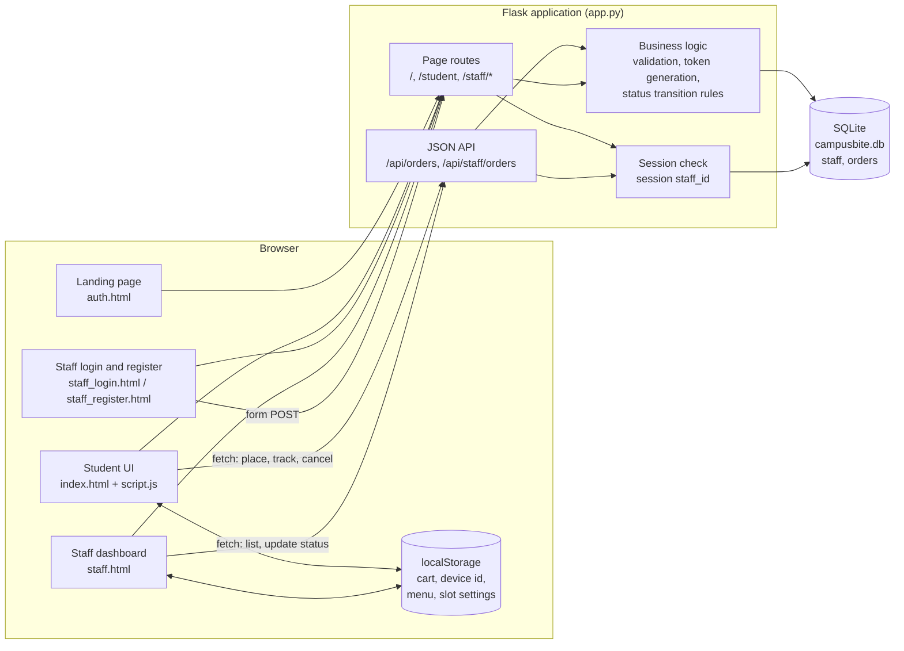
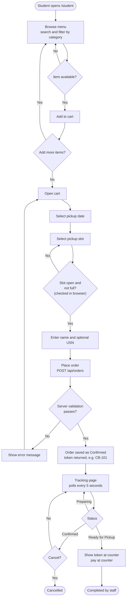
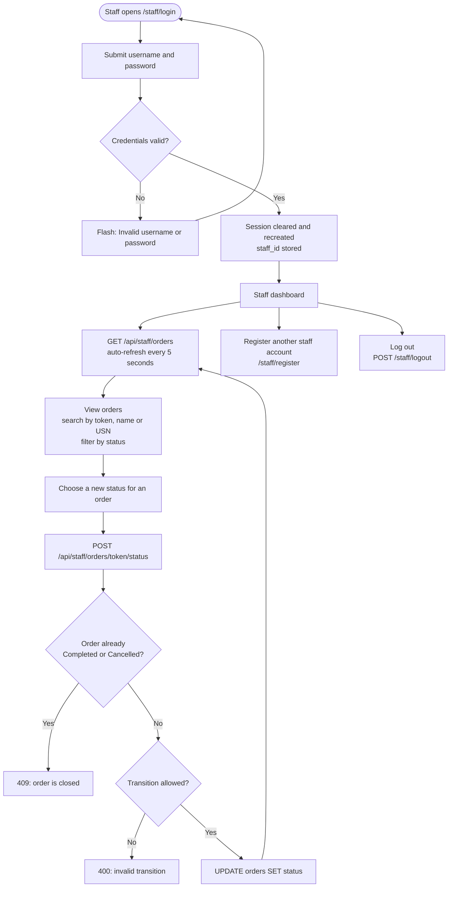
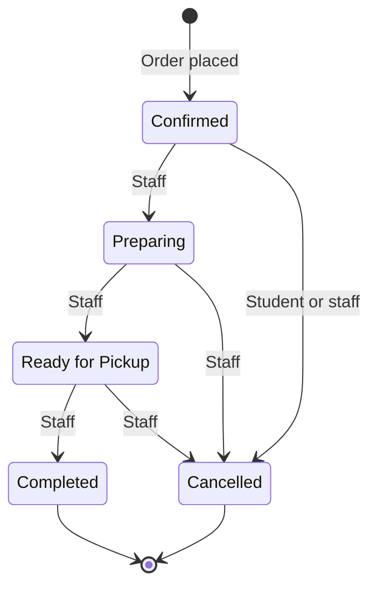
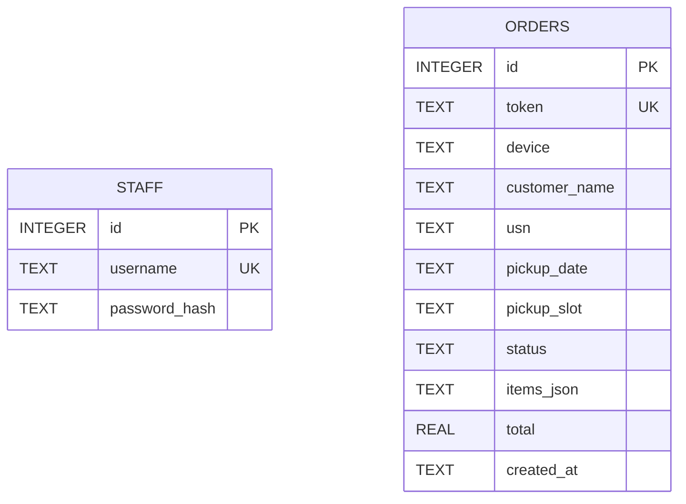
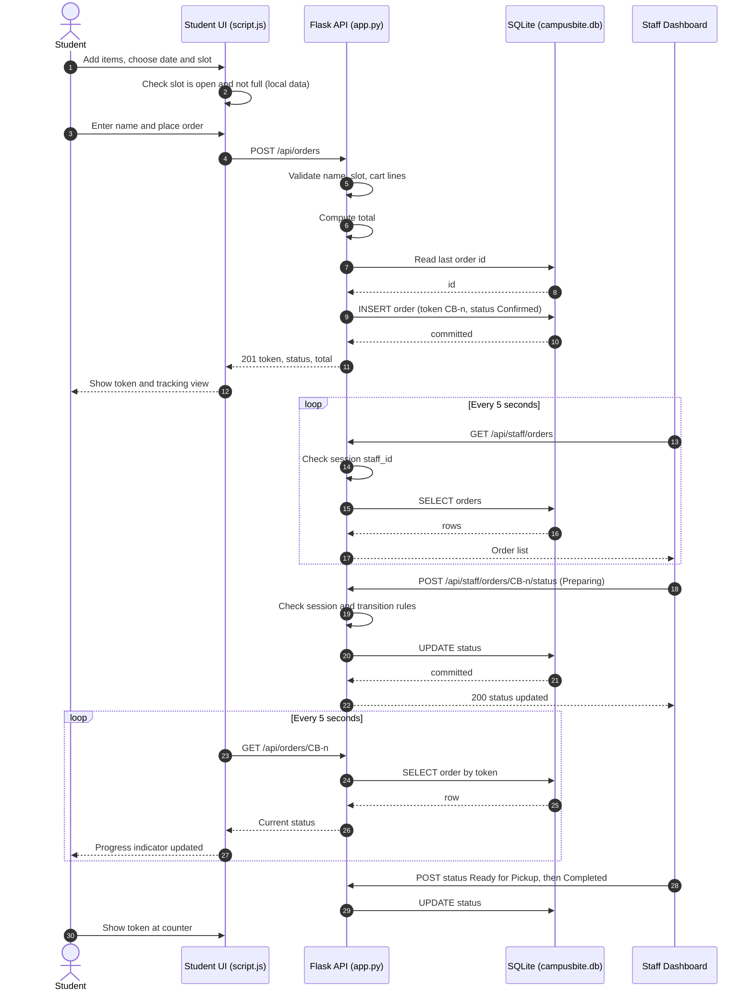

<div align="center">

# CampusBite

**A canteen pre-order and pickup-slot management system for university campuses**


[Overview](#project-overview) |
[Features](#key-features) |
[Architecture](#system-architecture) |
[Database](#database-design) |
[API](#api-documentation) |
[Setup](#installation-and-setup) |
[Security](#authentication-and-security)

</div>

---

## Project Overview

CampusBite is a web application that lets students pre-order food from a campus canteen, choose a pickup time slot, and track the order using a token. Canteen staff sign in to a protected dashboard where they review incoming orders and move each one through a fixed preparation lifecycle.

The application is built with Flask and SQLite on the server and vanilla JavaScript on the client. Orders and staff accounts are persisted in a SQLite database. Server-rendered Jinja2 templates deliver the pages, and a small JSON API connects the browser to the database.

### Problem Statement

Walk-up canteen service concentrates demand into a few break periods. Students queue to order, and staff have no advance view of how many orders are coming or what has to be prepared first. There is also no simple way for a student to know when an order is ready without standing at the counter.

### Proposed Solution

CampusBite separates ordering from collection. A student builds a cart, reserves a pickup slot and receives an order token. The token is used to watch the order move from Confirmed to Ready for Pickup. Staff see every order in a single dashboard, search it by token, name or USN, and advance its status. The student's tracking page polls the server and reflects the change without a manual refresh.

### Target Users

| User | Interaction with the system |
|------|-----------------------------|
| Student | Browses the menu, builds a cart, selects a pickup slot, places an order, tracks it by token, and cancels it while it is still Confirmed. No student account is required. |
| Canteen staff | Signs in, monitors all orders, searches and filters them, and updates order status. Authenticated staff can also register additional staff accounts. |

### Project Objectives

- Provide a complete pre-order flow: menu, cart, pickup slot, order token, and status tracking.
- Persist orders and staff credentials in a relational database rather than only in the browser.
- Enforce an explicit order lifecycle on the server so statuses cannot be changed arbitrarily.
- Restrict staff functionality behind session-based authentication with hashed passwords.
- Keep the stack small enough (one dependency, Flask) to run on any development machine.

> **Project status.** CampusBite is a classroom and demonstration project that runs locally on the Flask development server. It is not deployed, and it does not process payments. Payment is expected at the counter. See [Current Limitations](#current-limitations) for what is and is not enforced on the server.

---

## Key Features

### Student Module

Served at `/student` by `templates/index.html` and `static/script.js`.

| Feature | Implementation |
|---------|----------------|
| Menu browsing | 20 items in 4 categories (South Indian, Snacks, Rice & Noodles, Beverages), defined in `static/script.js`. Items can be filtered by category and searched by name or description. |
| Availability flag | Each item carries an `available` flag. Unavailable items are shown as sold out and cannot be added to the cart. |
| Cart | Add, increment, decrement and remove items. The cart persists in browser `localStorage` between visits. |
| Pickup slot selection | Slots are generated from configurable opening time, closing time and slot length (defaults: 09:30 to 16:30, 15-minute steps). Students can book for today and a configurable number of days ahead (default: 2). Each slot displays remaining capacity. |
| Slot closing rules | A slot is disabled when it is full (default capacity: 6 orders) or when the current time is within the cutoff window before it (default: 15 minutes). |
| Order placement | Submits the cart, name, optional USN, date and slot to `POST /api/orders`. The server stores the order and returns a token. |
| Order tracking | Look up any order by token. The page polls `GET /api/orders/<token>` every 5 seconds and displays a four-step progress indicator. |
| My orders | Orders placed from the current browser are listed through a per-browser device identifier stored in `localStorage`. |
| Order cancellation | A student can cancel an order only while its status is Confirmed, through `POST /api/orders/<token>/cancel`. |

### Staff Module

Served at `/staff/dashboard` by `templates/staff.html`. Requires a staff session.

| Feature | Implementation |
|---------|----------------|
| Staff authentication | Username and password login at `/staff/login`, verified against hashed passwords in the `staff` table. |
| Live order table | Loads all orders from `GET /api/staff/orders` and refreshes automatically every 5 seconds, with a manual refresh button. |
| Summary counters | Total orders, and counts of Confirmed, Preparing and Ready for Pickup orders. |
| Search and filter | Search by token, student name or USN. Filter by order status. |
| Status updates | A per-row selector offers only the valid next status and Cancelled. Changes are sent to `POST /api/staff/orders/<token>/status` and validated server-side. |
| Staff registration | A logged-in staff member can create additional staff accounts at `/staff/register`. |
| Logout | `POST /staff/logout` clears the session. |

### Landing Page

`/` renders `templates/auth.html`, a welcome page with entry points to the student canteen and the staff login.

### Implemented versus Prototype

Some staff-dashboard features exist in the interface but are not connected to the database. They are listed here so the current behaviour is not overstated.

| Area | Current behaviour |
|------|-------------------|
| Staff menu and availability tab | Edits prices and availability and can add items, stored only in the staff member's own browser (`localStorage` key `campusbite_staff_menu`). Changes do not reach the student menu and are not stored on the server. |
| Staff slots and settings tab | Stores opening time, closing time, slot interval, capacity, advance days and cutoff in `localStorage` (`campusbite_staff_settings`). These values are not read by the student page or the server. |
| Slot capacity and cutoff | Evaluated in the student's browser against orders held in that browser's `localStorage`. The server does not check them. |

Planned work that addresses these items is listed under [Future Enhancements](#future-enhancements).

---

## Technology Stack

| Technology | Purpose | Where it is used |
|------------|---------|------------------|
| Python 3.10+ | Application language | `app.py`, `create_staff.py` |
| Flask (`>=3.0,<4.0`) | Web framework, routing, sessions, Jinja2 rendering | `app.py` |
| Werkzeug | Password hashing and verification (installed with Flask) | `generate_password_hash` and `check_password_hash` in `app.py` and `create_staff.py` |
| SQLite (`sqlite3` standard library) | Embedded relational database | `campusbite.db`, `get_db()` and `initialize_database()` in `app.py` |
| Jinja2 (installed with Flask) | Server-side HTML templating | `templates/*.html` |
| Vanilla JavaScript (ES6, Fetch API) | Client logic, rendering, polling, API calls | `static/script.js`, inline scripts in `templates/staff.html` |
| Browser `localStorage` | Cart, device identifier, client-side menu and slot data | `static/script.js`, `templates/staff.html` |
| HTML5 and CSS3 | Page structure and styling | `templates/`, `static/style.css`, inline styles in the login, register and landing templates |
| Google Fonts | Typography (Inter, Poppins, DM Sans, Manrope) | Loaded from the Google Fonts CDN by the templates and `static/style.css` |
| Unsplash image URLs | Menu item photographs | Hotlinked in `static/script.js` (`FOOD_IMAGES`) |

The only declared Python dependency is Flask (`requirements.txt`). There is no build step and no JavaScript package manager.

---

## System Architecture

CampusBite is a single-process Flask application. The browser receives server-rendered pages, then calls JSON endpoints for dynamic data. All persistent state lives in one SQLite file.



### Data Flow

1. A request for `/student`, `/staff/login` or `/` returns a Jinja2 template. `/staff/dashboard` and `/staff/register` first check `session["staff_id"]` and redirect to the login page if it is absent.
2. The student page runs `static/script.js`. It holds the menu, cart and slot logic in the browser and calls the API only to create, read and cancel orders.
3. `POST /api/orders` validates the payload, generates a token, and inserts a row into `orders` with status `Confirmed`.
4. The staff dashboard calls `GET /api/staff/orders`, which requires a staff session and returns every order. Status changes go through `POST /api/staff/orders/<token>/status`, where the server checks the requested transition against a fixed table before updating the row.
5. Both dashboards poll every 5 seconds, so staff updates appear on the student tracking page without a manual reload.

---

## Application Workflow

### Student Ordering Flow



### Staff Order Management Flow



### Order Status Lifecycle

The five statuses and the permitted transitions are defined in `update_order_status()` in `app.py`. Completed and Cancelled are terminal.



Students can cancel only from Confirmed. Staff can cancel from any non-terminal state.

---

## Database Design

CampusBite uses SQLite with two tables, created by `initialize_database()` using `CREATE TABLE IF NOT EXISTS`. The database file is `campusbite.db`, located next to `app.py`.

### Schema

**`staff`**

| Column | Type | Constraints | Description |
|--------|------|-------------|-------------|
| `id` | INTEGER | Primary key, autoincrement | Staff identifier, stored in the session as `staff_id` |
| `username` | TEXT | Unique, not null | Login name |
| `password_hash` | TEXT | Not null | Werkzeug password hash. The plain password is never stored. |

**`orders`**

| Column | Type | Constraints | Description |
|--------|------|-------------|-------------|
| `id` | INTEGER | Primary key, autoincrement | Internal row identifier, used to derive the token |
| `token` | TEXT | Unique, not null | Public order token, format `CB-<number>` |
| `device` | TEXT | Nullable | Browser device identifier (truncated to 100 characters) |
| `customer_name` | TEXT | Not null | Student name |
| `usn` | TEXT | Nullable | Student university serial number |
| `pickup_date` | TEXT | Not null | Pickup date, `YYYY-MM-DD` |
| `pickup_slot` | TEXT | Not null | Pickup time, `HH:MM` |
| `status` | TEXT | Not null, default `'Confirmed'` | One of Confirmed, Preparing, Ready for Pickup, Completed, Cancelled |
| `items_json` | TEXT | Not null | JSON array of `{id, name, qty, price}` line items |
| `total` | REAL | Not null | Order total computed by the server from the submitted items |
| `created_at` | TEXT | Not null | ISO 8601 timestamp, second precision |

### Entity Relationship Diagram



### Design Notes

- **No foreign keys.** The two tables are independent. Orders are placed by students who do not have accounts, and an order does not record which staff member handled it. The diagram therefore shows no relationship, because the schema defines none.
- **Line items are embedded.** Order items are stored as JSON in `orders.items_json` instead of a separate order-items table. This keeps order creation to a single insert, at the cost of not being able to query items with SQL. Normalising this is listed under [Future Enhancements](#future-enhancements).
- **Uniqueness.** `orders.token` and `staff.username` are protected by `UNIQUE` constraints. A duplicate staff username raises `sqlite3.IntegrityError`, which the registration route reports as "That username already exists."

---

## Project Directory Structure

The paths below are relative to the application folder, the one that contains `app.py`.

```text
CampusBite/
├── app.py                  # Flask application: routes, API, auth, database access
├── create_staff.py         # Command-line script to create a staff account
├── requirements.txt        # Python dependencies (Flask)
├── README.txt              # Original plain-text run instructions
├── campusbite.db           # SQLite database (created automatically if missing)
├── static/
│   ├── script.js           # Student-side application logic (menu, cart, slots, API calls)
│   ├── style.css           # Shared stylesheet for the student and staff pages
│   ├── logo.png            # CampusBite logo
│   └── campusbite-hero.png # Background image for the landing and staff auth pages
└── templates/
    ├── auth.html           # Landing page (route: /)
    ├── index.html          # Student canteen page (route: /student)
    ├── staff_login.html    # Staff sign-in page
    ├── staff_register.html # Staff registration page (login required)
    └── staff.html          # Staff dashboard (login required)
```

| Path | Responsibility |
|------|----------------|
| `app.py` | Creates the Flask app, requires `CAMPUSBITE_SECRET_KEY`, configures session cookies, defines `get_db()` and `initialize_database()`, and registers all page and API routes. |
| `create_staff.py` | Imports `app.py`, initialises the database, prompts for a username and a password of at least 12 characters, and inserts a hashed staff record. Used to create the first staff account. |
| `static/script.js` | Holds the menu data, slot generation, cart, and rendering for the student interface. Sends order, track and cancel requests to the API. |
| `static/style.css` | Styling shared by `index.html` and `staff.html`. The landing, login and register templates carry their own inline styles. |
| `templates/staff.html` | Staff dashboard with its own inline script for loading orders, filtering, and posting status updates. |
| `campusbite.db` | Runtime data store. It is generated on first run and should not be committed with real data. |

A `screenshots/` directory is referenced by the [User Interface](#user-interface) section. It is not part of the current source and must be added to the repository.

---

## API Documentation

All endpoints are defined in `app.py`. API endpoints return JSON. Page routes return HTML or redirects.

### JSON API

| Method | Endpoint | Purpose | Authentication | Success | Error responses |
|--------|----------|---------|----------------|---------|-----------------|
| POST | `/api/orders` | Create an order | None | `201` | `400` invalid name, missing slot, or invalid cart |
| GET | `/api/orders/<token>` | Return the current state of one order | None (token is the only identifier) | `200` | `404` order not found |
| POST | `/api/orders/<token>/cancel` | Cancel an order | None (token is the only identifier) | `200` | `404` not found, `409` status is not Confirmed |
| GET | `/api/staff/orders` | List all orders, newest first | Staff session | `200` | `401` not logged in |
| POST | `/api/staff/orders/<token>/status` | Change an order's status | Staff session | `200` | `400` invalid status or transition, `401` not logged in, `404` not found, `409` order already closed |

### Page Routes

| Method | Route | Purpose | Authentication |
|--------|-------|---------|----------------|
| GET | `/` | Landing page | None |
| GET | `/student` | Student canteen interface | None |
| GET, POST | `/staff/login` | Staff sign-in form. Redirects to the dashboard if already signed in. | None |
| GET | `/staff/dashboard` | Staff dashboard | Staff session, otherwise redirect to `/staff/login` |
| GET, POST | `/staff/register` | Create another staff account | Staff session, otherwise redirect to `/staff/login` |
| POST | `/staff/logout` | Clear the session and redirect to login | None required |

<details>
<summary><strong>Request and response examples</strong></summary>

#### Create an order

`POST /api/orders`

```json
{
  "name": "Student Name",
  "usn": "OPTIONAL-USN",
  "date": "2026-11-04",
  "slot": "10:00",
  "device": "browser-generated-id",
  "items": [
    { "id": "idli", "name": "Idli", "qty": 2, "price": 30 }
  ]
}
```

Response `201 Created`:

```json
{
  "message": "Order confirmed.",
  "token": "CB-101",
  "status": "Confirmed",
  "total": 60.0
}
```

Validation rules enforced by the server:

- `name` must be at least 2 characters after trimming.
- `date` and `slot` must be non-empty.
- `items` must be a non-empty list of at most 50 entries.
- Each item needs an `id`, a `name`, an integer `qty` from 1 to 50, and a non-negative numeric `price`.

#### Read an order

`GET /api/orders/CB-101` returns:

```json
{
  "token": "CB-101",
  "name": "Student Name",
  "usn": "OPTIONAL-USN",
  "date": "2026-11-04",
  "slot": "10:00",
  "status": "Confirmed",
  "items": [{ "id": "idli", "name": "Idli", "qty": 2, "price": 30 }],
  "total": 60.0,
  "createdAt": "2026-11-03T10:15:30"
}
```

The token lookup is case-insensitive because the server upper-cases it.

#### Update an order status (staff)

`POST /api/staff/orders/CB-101/status`

```json
{ "status": "Preparing" }
```

Response `200 OK`:

```json
{
  "message": "Order status updated.",
  "token": "CB-101",
  "status": "Preparing"
}
```

Allowed status values: `Confirmed`, `Preparing`, `Ready for Pickup`, `Completed`, `Cancelled`. Allowed transitions are shown in the [status lifecycle](#order-status-lifecycle).

</details>

---

## User Interface

The interface uses a green and gold theme. The screenshots below are placeholders. Add the image files to a `screenshots/` folder at the repository root using the exact names shown.

<table>
  <tr>
    <td align="center" width="50%">
      <br>
      <sub><b>Landing page</b></sub>
    </td>
    <td align="center" width="50%">
      <br>
      <sub><b>Student home</b></sub>
    </td>
  </tr>
  <tr>
    <td align="center" width="50%">
      <br>
      <sub><b>Menu</b></sub>
    </td>
    <td align="center" width="50%">
      <br>
      <sub><b>Cart and pickup slot selection</b></sub>
    </td>
  </tr>
  <tr>
    <td align="center" colspan="2">
      <br>
      <sub><b>Staff dashboard</b></sub>
    </td>
  </tr>
</table>

---

## Installation and Setup

### Prerequisites

- Python 3.10 or newer
- `pip`
- Git
- An internet connection in the browser, for Google Fonts and menu photographs. The application still works without it, with fallback fonts and emoji icons in place of photographs.

### 1. Clone the Repository

```bash
git clone https://github.com/<your-username>/CampusBite.git
cd CampusBite
```

Replace `<your-username>` with the account that hosts the repository. Run the remaining commands from the folder that contains `app.py`.

### 2. Create a Virtual Environment

<details open>
<summary><strong>Windows (PowerShell)</strong></summary>

```powershell
py -m venv .venv
.\.venv\Scripts\Activate.ps1
```

If activation is blocked, allow scripts for the current session and retry:

```powershell
Set-ExecutionPolicy -Scope Process -ExecutionPolicy Bypass
```

</details>

<details>
<summary><strong>macOS and Linux</strong></summary>

```bash
python3 -m venv .venv
source .venv/bin/activate
```

</details>

### 3. Install Dependencies

```bash
python -m pip install -r requirements.txt
```

### 4. Set Environment Variables

The application refuses to start unless `CAMPUSBITE_SECRET_KEY` is set. It signs the session cookie.

| Variable | Required | Description |
|----------|----------|-------------|
| `CAMPUSBITE_SECRET_KEY` | Yes | Secret used to sign session cookies. Use a long random value. |
| `COOKIE_SECURE` | No | Set to `1` to mark the session cookie `Secure`. Use it only when serving over HTTPS. |

<details open>
<summary><strong>Windows (PowerShell)</strong></summary>

```powershell
$env:CAMPUSBITE_SECRET_KEY = python -c "import secrets; print(secrets.token_hex(32))"
```

</details>

<details>
<summary><strong>macOS and Linux</strong></summary>

```bash
export CAMPUSBITE_SECRET_KEY="$(python -c 'import secrets; print(secrets.token_hex(32))')"
```

</details>

These variables last for the current terminal session. Because the key changes each time it is regenerated, existing staff sessions become invalid after a restart with a new key.

### 5. Initialise the Database and Create the First Staff Account

The `orders` and `staff` tables are created automatically when the application is started with `python app.py`. A staff account is needed before the dashboard can be used, so create one now:

```bash
python create_staff.py
```

The script prompts for a username and a password of at least 12 characters, and stores only a hash of the password. Further staff accounts can be added from the dashboard at `/staff/register`.

### 6. Run the Application

```bash
python app.py
```

The server starts in Flask debug mode on `http://127.0.0.1:5000`.

### 7. Open the Application

| Page | URL |
|------|-----|
| Landing page | `http://127.0.0.1:5000/` |
| Student canteen | `http://127.0.0.1:5000/student` |
| Staff login | `http://127.0.0.1:5000/staff/login` |

### Resetting Demo Data

Stop the application, back up or delete `campusbite.db`, and start it again. A fresh database is created, and `create_staff.py` must be run again to add a staff account.

### Troubleshooting

| Symptom | Cause | Resolution |
|---------|-------|------------|
| `RuntimeError: Set CAMPUSBITE_SECRET_KEY before starting the app.` | The environment variable is not set in the current terminal. | Set it as shown in step 4, in the same terminal that runs the app. |
| `ModuleNotFoundError: No module named 'flask'` | Dependencies are not installed, or the virtual environment is not active. | Activate `.venv` and run `python -m pip install -r requirements.txt`. |
| `sqlite3.OperationalError: no such table: orders` | The app was started another way (for example `flask run`), which skips table creation. | Start it with `python app.py`, or run `python create_staff.py` once. |
| Staff login always fails | No staff account exists, or the password is wrong. | Run `python create_staff.py`. Passwords must be at least 12 characters. |
| `Address already in use` on port 5000 | Another process uses the port. | Stop that process, or change the `app.run(...)` call in `app.py` to use another port. |
| PowerShell refuses to run `Activate.ps1` | Script execution policy. | Run `Set-ExecutionPolicy -Scope Process -ExecutionPolicy Bypass`, then activate again. |
| Menu photographs or fonts do not load | The browser is offline or Unsplash and Google Fonts are blocked. | Connect to the internet. The page falls back to emoji icons and system fonts. |
| The cart or menu looks reset | Browser storage was cleared or blocked. | The cart, device id and menu data live in `localStorage` and are per browser. |

---

## Authentication and Security

### Implemented Mechanisms

| Area | Implementation |
|------|----------------|
| Staff authentication | Session-based. `staff_login()` looks up the username, verifies the password with `check_password_hash`, and stores `staff_id` and `staff_username` in the Flask session. |
| Session fixation protection | `session.clear()` runs before the new identity is stored at login, and again at logout. |
| Password storage | Passwords are hashed with Werkzeug's `generate_password_hash` before insertion. The plain text is never written to the database. |
| Password policy | Minimum 12 characters, enforced in both `create_staff.py` and `/staff/register`. Registration also requires a matching confirmation field. |
| Session cookie | Signed with `CAMPUSBITE_SECRET_KEY`. Configured `HttpOnly` and `SameSite=Lax`. `Secure` is enabled when `COOKIE_SECURE=1`. |
| Secret key handling | The key is read from the environment, never hard-coded. The application raises an error at start-up if it is missing. |
| Access control | `/staff/dashboard`, `/staff/register`, `GET /api/staff/orders` and `POST /api/staff/orders/<token>/status` check `session["staff_id"]`. Pages redirect to the login page. API routes return `401`. |
| Restricted registration | Staff accounts can only be created by an already authenticated staff member, or by running `create_staff.py` on the host machine. |
| Login error handling | A failed login returns a single generic message and does not reveal whether the username exists. |
| SQL injection | All queries use parameterised statements (`?` placeholders). |
| Output encoding | Jinja2 auto-escapes template output. Client-side rendering escapes user-supplied text, and the staff table builds cells with `textContent`. |
| Server-side state rules | Status changes are checked against a fixed transition table, and closed orders cannot be reopened. |

### Current Limitations

These are known gaps. They are documented here so the project is not mistaken for production-ready software.

| Limitation | Detail |
|------------|--------|
| No CSRF protection | State-changing form and API requests rely on `SameSite=Lax` only. |
| No rate limiting | Login, order creation and token lookup are not throttled. |
| Predictable tokens | Tokens are sequential (`CB-101`, `CB-102`, ...). Because `GET /api/orders/<token>` and the cancel endpoint need only the token, anyone can read the name and USN on an order, or cancel a Confirmed order, by guessing tokens. |
| Client-trusted pricing | The server computes the total from the `price` values sent by the browser. It does not look prices up from its own menu. |
| Client-only slot rules | Slot capacity, cutoff time, opening hours and booking window are checked in the browser only. The server accepts any non-empty date and slot. |
| Token generation race | The next token is derived from the last row id in a separate query before the insert. Two simultaneous orders could compute the same token. The `UNIQUE` constraint would reject the second insert rather than store a duplicate. |
| Development server and debug mode | `app.run(debug=True)` is used. It must not be exposed to an untrusted network. |
| Bundled database | The project archive includes a `campusbite.db` containing sample data and a staff record. Do not publish a database that holds real credentials or orders. |

---

## Order Processing

### Order Creation

1. The student fills the cart and picks a date and a slot. The browser checks that the slot is not closed or full, using the orders it holds locally.
2. `placeOrder()` in `static/script.js` sends the order to `POST /api/orders`.
3. The server trims and validates the name, requires a date and slot, and validates every cart line (quantity from 1 to 50, non-negative price, at most 50 lines).
4. The server computes `total` as the sum of `qty * price` over the validated lines.
5. A token is generated, the row is inserted with status `Confirmed`, and the token and total are returned.
6. The browser stores the order locally, clears the cart, and opens the tracking view.

### Token Generation

The token is built from the highest existing row id:

```python
next_id = (last["id"] if last else 0) + 1
token = f"CB-{100 + next_id}"
```

The first order on an empty database receives `CB-101`. Tokens are human-readable but sequential. See [Current Limitations](#current-limitations).

### Pickup Slot Handling

Slot generation and availability are implemented in `static/script.js` (`genSlots`, `slotInfo`, `dayList`). Defaults are an opening time of 09:30, a closing time of 16:30, 15-minute slots, a capacity of 6 orders per slot, a 15-minute cutoff, and a two-day booking window after today. The server stores the chosen `pickup_date` and `pickup_slot` as text and does not validate them against these rules.

### Status Updates

Staff change status through the dashboard. The server rejects a request when the status value is unknown (`400`), when the order does not exist (`404`), when the order is already Completed or Cancelled (`409`), or when the transition is not in the allowed table (`400`). A student can cancel an order only while it is Confirmed.

### Sequence Diagram



---

## Future Enhancements

The items below are **not implemented**. They are the most valuable next steps given the current limitations.

| Area | Planned improvement |
|------|---------------------|
| Server-side menu | Move the menu into the database (`menu_items` table) so prices and availability are authoritative on the server, and connect the staff menu editor to it. |
| Server-side pricing | Recompute order totals from database prices and reject unknown or unavailable items. |
| Server-side slot rules | Validate date, slot, capacity, cutoff and opening hours in `POST /api/orders`, and store slot settings in the database. |
| Token privacy | Replace sequential tokens with unpredictable ones, or require a second factor (for example the USN or a per-order secret) to read or cancel an order. |
| Security hardening | Add CSRF protection, rate limiting on login and order endpoints, and security headers. |
| Data model | Normalise `items_json` into an `order_items` table with foreign keys, and record which staff member changed each status. |
| Deployment | Serve with a production WSGI server behind HTTPS, disable debug mode, and keep the database and secrets out of version control. |
| Notifications | Notify the student when the order reaches Ready for Pickup. |
| Reporting | Daily sales and popular-item summaries for staff. |
| Quality | Automated tests for the API and status transitions, and a continuous integration workflow. |

---

## Contribution Guidelines

Contributions are welcome.

1. **Fork** the repository using the Fork button on GitHub.
2. **Clone** your fork and create a feature branch:

   ```bash
   git clone https://github.com/<your-username>/CampusBite.git
   cd CampusBite
   git checkout -b feature/short-description
   ```

3. **Make your changes.** Keep changes focused, follow the existing code style, and do not commit `campusbite.db`, virtual environments or secrets.
4. **Test locally.** Run the application, and exercise the student flow and the staff flow affected by your change.
5. **Commit** with a clear message:

   ```bash
   git add .
   git commit -m "Add short description of the change"
   git push origin feature/short-description
   ```

6. **Open a pull request** against the main branch. Describe what changed and why, and include screenshots for interface changes.

---

## License

This repository currently has no specified license. Until a license file is added, all rights are reserved by the author, and reuse or redistribution requires the author's permission.

---

## Developer Information

| | |
|---|---|
| **Developer** | Anurudh K. |
| **Degree** | B.Tech in Artificial Intelligence and Machine Learning |
| **Institution** | Srinivas University Institute of Engineering and Technology |
| **Location** | Mangaluru, Karnataka, India |

---

## Acknowledgements

- The faculty and mentors at Srinivas University Institute of Engineering and Technology for their guidance.
- The [Flask](https://flask.palletsprojects.com/) and [Werkzeug](https://werkzeug.palletsprojects.com/) projects, and the SQLite project, for the foundations the application is built on.
- [Google Fonts](https://fonts.google.com/) for the typefaces, and [Unsplash](https://unsplash.com/) for the menu photography referenced by URL.

## Conclusion

CampusBite demonstrates an end-to-end ordering workflow on a deliberately small stack: a validated order API, database-backed persistence, token-based tracking, a session-protected staff dashboard, and a server-enforced order lifecycle. It also documents its own boundaries. Menu data, pricing authority, and slot capacity are the main areas that still live in the browser, and moving them to the server is the clearest path from a working prototype to a deployable system.
